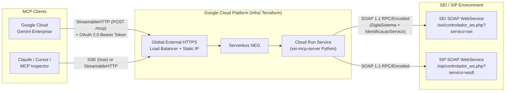

# 🏛️ SEI MCP Server (Python) — Model Context Protocol for SEI WebServices v3.1+

An enterprise-grade **Model Context Protocol (MCP)** server built in **Python** that exposes the official **SEI (Sistema Eletrônico de Informações)** SOAP Web Services (`SEI-WebServices-v3.1.pdf` / `sei.wsdl`), **SIP (Sistema de Permissões)** Web Services, and **External RH** Web Services as **72 structured MCP tools** for **Google Cloud Gemini Enterprise**, Claude Desktop, Cursor, and MCP Inspector.

---

## ✨ Key Features

- **Complete SEI v3.1+ Coverage (72 MCP Tools)**:
  - **25 Process & Workflow (`Procedimentos`) Tools**: `gerarProcedimento`, `consultarProcedimento`, `consultarProcedimentoIndividual`, `enviarProcesso`, `concluirProcesso`, `reabrirProcesso`, `sobrestarProcesso`, `removerSobrestamentoProcesso`, `anexarProcesso`, `desanexarProcesso`, `relacionarProcesso`, `removerRelacionamentoProcesso`, `atribuirProcesso`, `lancarAndamento`, `listarAndamentos`, `registrarAnotacao`, `bloquearProcesso`, `desbloquearProcesso`, `adicionarMarcador`, `removerMarcador`, `listarAndamentosMarcadores`, `definirControlePrazo`, `concluirControlePrazo`, `removerControlePrazo`, `listarExtensoesPermitidas`.
  - **13 Document & File (`Documentos` & `Arquivos`) Tools**: `incluirDocumento`, `consultarDocumento`, `cancelarDocumento`, `gerarBloco`, `adicionarArquivo`, `adicionarConteudoArquivo`, `listarHipotesesLegais`, `listarTiposConferencia`, `agendarPublicacao`, `alterarPublicacao`, `cancelarAgendamentoPublicacao`, `consultarPublicacao`, `enviarEmail`.
  - **12 Signature, Meeting & Internal Block (`Blocos`) Tools**: `incluirDocumentoBloco`, `retirarDocumentoBloco`, `incluirProcessoBloco`, `retirarProcessoBloco`, `disponibilizarBloco`, `cancelarDisponibilizacaoBloco`, `excluirBloco`, `reabrirBloco`, `devolverBloco`, `consultarBloco`, `listarBlocos`, `concluirBloco`.
  - **17 Catalog & Parameter (`Parâmetros`) Tools**: `listarUnidades`, `listarTiposProcedimento`, `listarSeries`, `listarContatos`, `atualizarContatos`, `listarUsuarios`, `listarPaises`, `listarEstados`, `listarCidades`, `listarCargos`, `listarFeriados`, `listarMarcadoresUnidade`, `definirMarcador`, `listarTiposPrioridade`, `confirmarDisponibilizacaoPublicacao`, `enviarNotificacaoPublicacao`, `SinalizarDocumento`.
  - **3 SIP Permission (`SIP`) Tools**: `sip_listarPermissao`, `sip_replicarPermissao`, `sip_replicarUsuario`.
  - **1 External HR (`RH`) Tool**: `rh_listarCargoFuncao`.
  - **1 Diagnostic Tool**: `get_system_info`.
- **Dual-Transport HTTP Server (`StreamableHTTP` & `SSE`) + `stdio`**:
  - `POST /mcp`: Modern MCP **StreamableHTTP** transport (used by Google Cloud Gemini Enterprise).
  - `GET /sse` & `POST /messages?sessionId=...`: Legacy MCP **Server-Sent Events (SSE)** transport.
  - `--stdio`: Standard input/output transport for local CLI / IDE agents.
- **Gemini Enterprise OAuth 2.0 Authentication & Discovery**:
  - Exposes RFC 9728 `GET /.well-known/oauth-protected-resource` and RFC 8414 `GET /.well-known/oauth-authorization-server`.
  - Allows unauthenticated MCP discovery handshakes (`initialize`, `notifications/initialized`, `ping`, `tools/list`) so Gemini Enterprise's **"Validate & Save"** and **"Reload custom actions"** always succeed.
  - Enforces Google OAuth 2.0 Bearer token validation (via `https://oauth2.googleapis.com/tokeninfo`) and optional `OAUTH_CLIENT_ID` audience verification on all `tools/call` tool executions in production.
- **Official SEI SOAP 1.1 RPC/Encoded Integration**:
  - Parses `sei-documentation/sei.wsdl` to serialize all `<wsdl:part>` parameters in exact positional order as required by PHP's `SoapServer` (`controlador_ws.php?servico=sei`).
  - Handles `SOAP-ENC:Array` (`<item>` elements), `xsi:nil="true"` optional fields, Base64 encoding, and MD5 checksum helpers for `incluirDocumento` and `adicionarArquivo`.

---

## 🏗️ System Architecture



---

## 🔐 Authentication Architecture

This server implements two distinct authentication layers:

### 1. Inbound Authentication: Gemini Enterprise -> MCP Server (OAuth 2.0)

Following the Gemini Enterprise MCP specification (mirrored from `sei-mcp-prodesp`):

| Endpoint / Method | Auth Requirement | Purpose |
| :--- | :--- | :--- |
| `GET /health` | Public | Liveness & readiness probe |
| `GET /.well-known/oauth-protected-resource` | Public | RFC 9728 OAuth 2.0 Protected Resource Metadata |
| `GET /.well-known/oauth-authorization-server` | Public | RFC 8414 OAuth 2.0 Authorization Server Metadata |
| `POST /mcp` (`initialize`, `notifications/initialized`, `ping`, `tools/list`) | Public | Allows Gemini Enterprise to discover tools during connector registration |
| `POST /mcp` (`tools/call`) | **OAuth 2.0 Bearer Token** | Validates Google OAuth 2.0 access token & `OAUTH_CLIENT_ID` audience |

- In **Production** (`ENV=production` and `OAUTH_ENABLED=true`): Every `tools/call` invocation must carry `Authorization: Bearer <google_access_token>`.
- In **Local Development** (`ENV=development` and `OAUTH_ENABLED=false`): `tools/call` can be invoked without an OAuth token for rapid testing.

### 2. Outbound Authentication: MCP Server -> SEI Web Services (`SEI-WebServices-v3.1.pdf`)

Per the official **SEI WebServices v3.1 Manual** (`sei-documentation/SEI-WebServices-v3.1.pdf`, pages 5–8), every SOAP operation authenticates using:
1. **`SiglaSistema`** (`SEI_SIGLA_SISTEMA`): System acronym registered in SEI under *Administração -> Sistemas -> Novo*.
2. **`IdentificacaoServico`** (`SEI_IDENTIFICACAO_SERVICO`): Either:
   - The **72-character Access Key (`Chave de Acesso`)** generated in SEI (*Administração -> Sistemas -> Serviços -> Chave de Acesso*) — **recommended by SEI v3.1+**, OR
   - The plain-text service name (`Identificação`) prefixed by its SHA-256 hash when authenticating against legacy SEI 3.0 services.
3. **IP Whitelisting (`Servidores`)**: In SEI under *Administração -> Sistemas -> listar -> Serviços -> Servidores*, register the outbound IP address (or CIDR mask) of the MCP server so SEI permits SOAP calls for the configured operations (`Operações`).
4. **`IdUnidade`** (`SEI_ID_UNIDADE`): Default organizational unit ID automatically injected when not explicitly passed by the user in a tool call.

---

## 🧰 Complete Catalog of 72 MCP Tools

### 🩺 System & Diagnostics (1 Tool)
| Tool Name | Description |
| :--- | :--- |
| `get_system_info` | Returns server status, configured SEI/SIP endpoints, default unit ID, and registered tool count. |

### 📁 Process & Workflow Tools — `src/tools/processos.py` (25 Tools)
| Tool Name | SEI WSDL Operation | Description |
| :--- | :--- | :--- |
| `gerarProcedimento` | `gerarProcedimento` | Creates a new administrative process (`Procedimento`) with optional initial documents, subjects, interested parties, and destination units. |
| `consultarProcedimento` | `consultarProcedimento` | Queries comprehensive metadata of a process (subjects, interested parties, units, open locations, related/annexed processes). |
| `consultarProcedimentoIndividual` | `consultarProcedimentoIndividual` | Queries individual process metadata in a specific context. |
| `enviarProcesso` | `enviarProcesso` | Forwards (`tramita`) a process to one or more destination units (`UnidadesDestino`). |
| `concluirProcesso` | `concluirProcesso` | Concludes (`fecha`) a process in the specified unit. |
| `reabrirProcesso` | `reabrirProcesso` | Reopens a previously concluded process in the specified unit. |
| `sobrestarProcesso` | `sobrestarProcesso` | Suspends (`sobresta`) a process, optionally linking it to another process. |
| `removerSobrestamentoProcesso` | `removerSobrestamentoProcesso` | Removes the suspension (`sobrestamento`) from a process. |
| `anexarProcesso` | `anexarProcesso` | Annexes a subsidiary process (`ProtocoloProcedimentoAnexado`) to a principal process. |
| `desanexarProcesso` | `desanexarProcesso` | Detaches (`desanexa`) an annexed process from its principal process. |
| `relacionarProcesso` | `relacionarProcesso` | Creates a bidirectional link (`relacionamento`) between two processes. |
| `removerRelacionamentoProcesso` | `removerRelacionamentoProcesso` | Removes a relationship link between two processes. |
| `atribuirProcesso` | `atribuirProcesso` | Assigns (`atribui`) a process to a specific user (`IdUsuario`) within the unit. |
| `lancarAndamento` | `lancarAndamento` | Records a workflow progress entry (`andamento`) in the process history. |
| `listarAndamentos` | `listarAndamentos` | Lists workflow history entries (`andamentos`) for a process. |
| `registrarAnotacao` | `registrarAnotacao` | Registers or updates a unit note (`anotação`) on one or more processes. |
| `bloquearProcesso` | `bloquearProcesso` | Locks (`bloqueia`) a process to prevent modifications. |
| `desbloquearProcesso` | `desbloquearProcesso` | Unlocks (`desbloqueia`) a previously locked process. |
| `adicionarMarcador` | `adicionarMarcador` | Applies unit markers/tags (`marcadores`) to one or more processes. |
| `removerMarcador` | `removerMarcador` | Removes unit markers/tags (`marcadores`) from one or more processes. |
| `listarAndamentosMarcadores` | `listarAndamentosMarcadores` | Lists the history of marker changes on a process in the unit. |
| `definirControlePrazo` | `definirControlePrazo` | Sets a deadline (`controle de prazo` by date or days) on one or more processes. |
| `concluirControlePrazo` | `concluirControlePrazo` | Marks a deadline control as completed on one or more processes. |
| `removerControlePrazo` | `removerControlePrazo` | Removes a deadline control from one or more processes. |
| `listarExtensoesPermitidas` | `listarExtensoesPermitidas` | Lists file extensions permitted for external document uploads in SEI. |

### 📄 Document & File Tools — `src/tools/documentos.py` (13 Tools)
| Tool Name | SEI WSDL Operation | Description |
| :--- | :--- | :--- |
| `incluirDocumento` | `incluirDocumento` | Includes a generated (`G`) or external (`R`) document in a process (supports automatic Base64 encoding via `ConteudoTextoPlano`). |
| `consultarDocumento` | `consultarDocumento` | Queries document metadata, signatures, publication data, and view link (`LinkAcesso`). |
| `cancelarDocumento` | `cancelarDocumento` | Cancels a document with justification (`Motivo`). |
| `gerarBloco` | `gerarBloco` | Creates a new Signature (`A`), Internal (`I`), or Meeting (`R`) block. |
| `adicionarArquivo` | `adicionarArquivo` | Starts a chunked file upload (`IdArquivo`) with automatic Base64 & MD5 calculation if `ConteudoTextoPlano` is supplied. |
| `adicionarConteudoArquivo` | `adicionarConteudoArquivo` | Appends a Base64 content chunk to an in-progress `IdArquivo` upload. |
| `listarHipotesesLegais` | `listarHipotesesLegais` | Lists legal hypotheses (`Hipóteses Legais`) for restricted (`Restrito`) or confidential (`Sigiloso`) access levels. |
| `listarTiposConferencia` | `listarTiposConferencia` | Lists authentication/certification types (`Tipos de Conferência`) for external documents. |
| `agendarPublicacao` | `agendarPublicacao` | Schedules a document for official publication (`Publicação`). |
| `alterarPublicacao` | `alterarPublicacao` | Modifies an existing publication schedule. |
| `cancelarAgendamentoPublicacao` | `cancelarAgendamentoPublicacao` | Cancels a scheduled document publication. |
| `consultarPublicacao` | `consultarPublicacao` | Queries publication details by publication ID, document ID, or protocol. |
| `enviarEmail` | `enviarEmail` | Sends an official email from within a process (`Procedimento`), recording the email as a process document. |

### 📦 Block, Catalog, SIP & RH Tools — `src/tools/parametros.py` (33 Tools)
| Tool Name | Service / WSDL Operation | Description |
| :--- | :--- | :--- |
| `incluirDocumentoBloco` | SEI: `incluirDocumentoBloco` | Adds a document to a signature (`A`) or internal/meeting block (`IdBloco`). |
| `retirarDocumentoBloco` | SEI: `retirarDocumentoBloco` | Removes a document from a block. |
| `incluirProcessoBloco` | SEI: `incluirProcessoBloco` | Adds a process (`ProtocoloProcedimento`) to an internal or meeting block. |
| `retirarProcessoBloco` | SEI: `retirarProcessoBloco` | Removes a process from a block. |
| `disponibilizarBloco` | SEI: `disponibilizarBloco` | Makes a block available (`disponibiliza`) to its destination units. |
| `cancelarDisponibilizacaoBloco` | SEI: `cancelarDisponibilizacaoBloco` | Cancels the availability of a block. |
| `excluirBloco` | SEI: `excluirBloco` | Deletes one or more blocks (`IdBlocos`). |
| `reabrirBloco` | SEI: `reabrirBloco` | Reopens a concluded block. |
| `devolverBloco` | SEI: `devolverBloco` | Returns (`devolve`) a block received from another unit. |
| `consultarBloco` | SEI: `consultarBloco` | Queries details of a block and optionally lists its protocols (`SinRetornarProtocolos`). |
| `listarBlocos` | SEI: `listarBlocos` | Lists blocks filtered by type (`A`, `R`, `I`), state (`G`, `D`, `R`, `C`), and unit. |
| `concluirBloco` | SEI: `concluirBloco` | Concludes one or more blocks. |
| `listarUnidades` | SEI: `listarUnidades` | Lists organizational units (`Unidades`) permitted for the service. |
| `listarTiposProcedimento` | SEI: `listarTiposProcedimento` | Lists process types (`Tipos de Processo`). |
| `listarSeries` | SEI: `listarSeries` | Lists document types (`Séries`). |
| `listarContatos` | SEI: `listarContatos` | Searches contacts (`Contatos`) by type, words, CPF/CNPJ, or IDs. |
| `atualizarContatos` | SEI: `atualizarContatos` | Creates (`I`), alters (`A`), or deactivates (`E`) contact records in batch. |
| `listarUsuarios` | SEI: `listarUsuarios` | Lists users with permission in the unit. |
| `listarPaises` | SEI: `listarPaises` | Lists countries (`Países`) registered in SEI. |
| `listarEstados` | SEI: `listarEstados` | Lists states/provinces (`UF`) registered in SEI. |
| `listarCidades` | SEI: `listarCidades` | Lists cities (`Municípios` + IBGE code) registered in SEI. |
| `listarCargos` | SEI: `listarCargos` | Lists official titles/positions (`Cargos`). |
| `listarFeriados` | SEI: `listarFeriados` | Lists holidays (`Feriados`) for an organ within a date range. |
| `listarMarcadoresUnidade` | SEI: `listarMarcadoresUnidade` | Lists markers (`Marcadores`) available in the unit. |
| `definirMarcador` | SEI: `definirMarcador` | Creates or updates unit marker definitions (`DefinicaoMarcador`). |
| `listarTiposPrioridade` | SEI: `listarTiposPrioridade` | Lists priority types (`Tipos de Prioridade`). |
| `confirmarDisponibilizacaoPublicacao` | SEI: `confirmarDisponibilizacaoPublicacao` | Confirms publication availability in an external publication vehicle. |
| `enviarNotificacaoPublicacao` | SEI: `enviarNotificacaoPublicacao` | Sends a publication notification in SEI. |
| `SinalizarDocumento` | SEI: `SinalizarDocumento` | Applies visual flags/signals (`Sinalizações`) to documents. |
| `sip_listarPermissao` | SIP: `listarPermissao` | Queries permissions registered in SIP (Sistema de Permissões). |
| `sip_replicarPermissao` | SIP: `replicarPermissao` | Replicates permissions in SIP across users/units. |
| `sip_replicarUsuario` | SIP: `replicarUsuario` | Replicates/synchronizes user records in SIP (`I` include, `A` alter, `D` deactivate, `R` reactivate, `C` query). |
| `rh_listarCargoFuncao` | RH: `listarCargoFuncao` | Queries job titles/functions (`Cargo/Função`) from an external HR SOAP Web Service. |

---

## 🚀 Quickstart (Local Development)

### 1. Clone & Configure Environment

```bash
cp .env.example .env
```

Edit `.env` with your SEI credentials:

```dotenv
PORT=3000
HOST=0.0.0.0
ENV=development
OAUTH_ENABLED=false

# SEI SOAP WebService Configuration
SEI_WS_URL=https://sei.orgao.gov.br/sei/controlador_ws.php?servico=sei
SEI_SIGLA_SISTEMA=MCP_GEMINI
SEI_IDENTIFICACAO_SERVICO=<72-character-chave-de-acesso>
SEI_ID_UNIDADE=110000958
SEI_VERIFY_SSL=true
SEI_TIMEOUT_SECONDS=60

# Optional SIP & RH WebService URLs
SIP_WS_URL=https://sei.orgao.gov.br/sip/controlador_ws.php?servico=wsdl
RH_WS_URL=
```

### 2. Install Dependencies (Optional if system packages are present)

```bash
pip install -r requirements.txt
```

### 3. Run the Server

```bash
# Start Dual-Transport HTTP Server (StreamableHTTP /mcp + SSE /sse)
python3 -m src.server

# Or run over stdio transport for local CLI clients
python3 -m src.server --stdio
```

### 4. Run Unit & cURL Integration Tests

```bash
# Run Python unit test suite (WSDL parser, SOAP serializer, MCP JSON-RPC, OAuth 2.0)
python3 -m unittest discover -s tests -v

# Run automated 13-test cURL suite against a running server
./scripts/test-mcp-curl.sh --url http://localhost:3000
```

---

## ☁️ Deploying to Google Cloud Run with Terraform

### Step 1: Build and Push Container Image via Cloud Build

```bash
gcloud builds submit --config=cloudbuild.yaml --project=YOUR_GCP_PROJECT_ID
```

### Step 2: Provision Cloud Run + Global HTTPS Load Balancer with Terraform

The `infra/` directory provisions:
- Google Cloud APIs (`run.googleapis.com`, `compute.googleapis.com`)
- **Cloud Run v2 Service** running `sei-mcp-server`
- **Global Static IP Address** + **Google-Managed SSL Certificate**
- **Global External Application Load Balancer** + **Serverless NEG**

```bash
cd infra
cp terraform.tfvars.example terraform.tfvars
# Edit terraform.tfvars with your project_id, domain, and SEI credentials
terraform init
terraform plan
terraform apply
```

See [infra/README.md](infra/README.md) for detailed DNS and SSL certificate provisioning instructions.

---

## 🤖 Connecting to Google Cloud Gemini Enterprise

1. Open the **Google Cloud Console -> Gemini Enterprise -> Extensions / Custom Actions (MCP)**.
2. Click **Add MCP Server** and configure:
   - **Server URL**: `https://<YOUR_LOAD_BALANCER_DOMAIN>/mcp`
   - **Transport**: `Streamable HTTP`
   - **Authentication**: `OAuth 2.0`
     - **Client ID**: Matches `OAUTH_CLIENT_ID` configured on Cloud Run
     - **Client Secret**: Your Google OAuth 2.0 Client Secret
     - **Authorization URL**: `https://accounts.google.com/o/oauth2/v2/auth`
     - **Token URL**: `https://oauth2.googleapis.com/token`
     - **Scopes**: `openid email profile`
3. Click **Validate & Save**. Gemini Enterprise will perform an unauthenticated `initialize` and `tools/list` handshake to discover all **72 SEI tools**, and will attach the end-user's OAuth 2.0 Bearer token on every `tools/call` execution.

---

## 📂 Project Structure

```text
sei-mcp/
├── src/
│   ├── __init__.py
│   ├── config.py              # Environment & SEI/OAuth configuration loader
│   ├── auth.py                # Google OAuth 2.0 token verifier & MCP discovery bypass
│   ├── mcp_server.py          # JSON-RPC 2.0 MCP router (initialize, tools/list, tools/call)
│   ├── server.py              # Dual-transport HTTP server (/mcp, /sse, /messages, /health)
│   ├── client/
│   │   ├── __init__.py
│   │   └── sei_client.py      # WSDL parser & SOAP 1.1 RPC/Encoded client for SEI/SIP/RH
│   └── tools/
│       ├── __init__.py        # Registers all 72 MCP tools
│       ├── processos.py       # 25 Process & workflow tools
│       ├── documentos.py      # 13 Document, file upload, publication & email tools
│       └── parametros.py      # 12 Block tools + 17 Catalog tools + 3 SIP + 1 RH tool
├── tests/
│   ├── test_wsdl_and_soap.py  # Unit tests for WSDL parsing & SOAP 1.1 serialization
│   └── test_mcp_server.py     # Unit tests for MCP JSON-RPC & OAuth 2.0 middleware
├── scripts/
│   └── test-mcp-curl.sh       # Automated 13-test cURL test suite (/health, /mcp, /sse)
├── infra/                     # Terraform IaC (Cloud Run v2 + Global HTTPS Load Balancer)
├── sei-documentation/         # Official SEI WebServices v3.1 PDF manual & sei.wsdl
├── Dockerfile                 # Production Python 3.12 Slim container image
├── cloudbuild.yaml            # Google Cloud Build pipeline
├── pyproject.toml             # Python packaging & pytest/ruff/mypy configuration
└── requirements.txt           # Pinned Python dependencies
```

---

## 📄 License

Licensed under the [MIT License](LICENSE).
